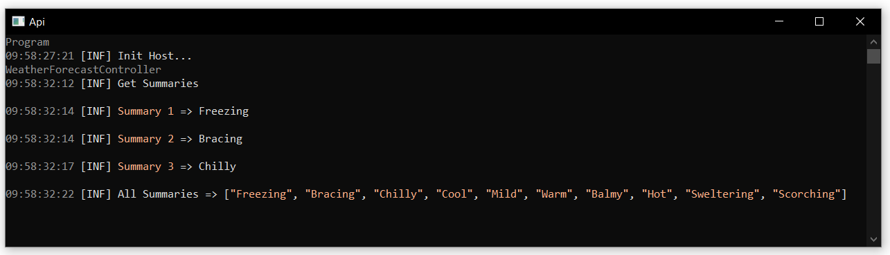
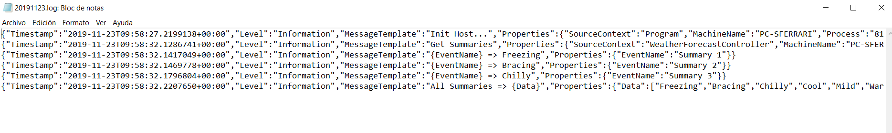
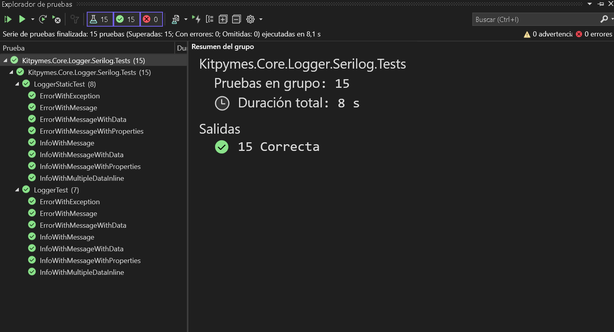

#  Kitpymes.Core.Logger

**Logeo de errores para multiples proveedores**

[](https://github.com/kitpymes/kitpymes-core-logger/actions/workflows/ci.yml)
[](https://www.nuget.org/packages/Kitpymes.Core.Logger/)
[](https://www.nuget.org/stats/packages/Kitpymes.Core.Logger?groupby=Version)
[](https://github.com/kitpymes/kitpymes-core-logger/blob/master/docs/LICENSE.txt)
[](https://github.com/kitpymes/kitpymes-core-logger/)
[](https://github.com/kitpymes/kitpymes-core-logger/)

## 📋 Requerimientos 

* Visual Studio 2026 o superior

* NET TargetFramework = net10.0

* SDK de .NET = 10.0.x

* C# = 12

* Conocimientos sobre Inyección de Dependencias

## 🔧 Instalación 

_Logger se puede instalar usando el administrador de paquetes Nuget o CLI dotnet._

_Nuget_

```
Install-Package Kitpymes.Core.Logger
```

_CLI dotnet_

```
dotnet add package Kitpymes.Core.Logger
```

## ⌨️ Código

### Registro con appsettings.json

```csharp
var builder = WebApplication.CreateBuilder(args);

builder.Logging.ClearProviders(); // opcional: sólo Serilog (si no, la consola de Microsoft repite cada evento)
builder.Logging.AddKitpymesLogging(builder.Configuration); // lee la sección LoggerSettings
```

```json
"LoggerSettings": {
  "Enabled": true,
  "IsSerilogEnabled": true,
  "SerilogSettings": {
    "MinimumLevel": "Info",                         // Trace, Debug, Info, Warn, Error, Fatal
    "MinimumLevelOverride": { "Microsoft": "Warning" }, // por defecto Microsoft y System en Warning
    "Console": { "Enabled": true },
    "File": { "Enabled": true, "FilePath": "Logs/.log", "MinimumLevel": "Error", "Interval": "Day" },
    "Email": { "Enabled": false },
    "SqlServer": { "Enabled": false }
  }
}
```

### Registro con opciones

```csharp
builder.Logging.AddKitpymesLogging(o => o.UseSerilog(serilog => serilog
    .AddMinimunLevel(LoggerLevel.Debug)
    .AddConsole()
    .AddFile("Logs/.log", LoggerLevel.Error)));

// O sólo el adaptador de Serilog, con su configuración:
builder.Logging.AddKitpymesSerilog(new SerilogSettings { Console = new SerilogConsoleSettings { Enabled = true } });
```

### Uso

```csharp
public class LoginHandler(ILogger<LoginHandler> logger)
{
    public void Handle(LoginCommand command)
    {
        logger.LogInformation("Login de {UserName}", command.UserName); // plantillas: no interpolar
        logger.LogInformation("Petición {@Command}", command);           // Password sale como ***
    }
}
```

### Arranque (antes de tener el contenedor)

```csharp
using var arranque = KitpymesSerilog.CreateLoggerFactory(o => o.AddConsole().AddFile("Logs/start_host/.log"));
var logger = arranque.CreateLogger<Program>();

try
{
    logger.LogInformation("Arranca...");
    // ...
}
catch (Exception ex)
{
    logger.LogCritical(ex, "El host no ha podido arrancar");
}
// Al liberar la fábrica (using) se escriben los eventos pendientes.
```

### Datos sensibles

Antes de llegar a cualquier sink, cada evento pasa por la ocultación (`***`):

- Propiedades y miembros (objetos con `{@X}`, diccionarios, listas) cuyo nombre es de credencial: password, pass, pwd, contraseña, clave, secret, token, apikey, connectionstring, authorization, cookie, pin, otp, cvv, iban, privatekey, credentials… Se compara por palabras: `UserPassword` sí, `CancellationToken` o `Secretaria` no (`SensitiveDataNames.IsSensitive`).
- Miembros marcados con `[Sensitive]` (al desestructurar, `{@X}`), para datos que no son credenciales (DNI, por ejemplo).
- En el texto, también el de la plantilla del mensaje: valores de claves JSON, `clave=valor` y `clave: valor` (cadenas de conexión, `ToString()` de un record, parámetros de URL), `Bearer` y contraseñas en URL.
- Si ocultar falla, se escribe que el evento se descartó, nunca el original.

No cubre: datos personales sin `[Sensitive]`, mensajes de excepciones, objetos con un `ToString()` propio sin forma `clave=valor` ni texto libre sin clave ("la contraseña es x"). Recomendado: CA2254 como error en el proyecto (plantillas fijas).

### Migración desde la 2.x

Guía punto por punto, con ejemplos de antes y después, en las [notas de la 3.0.0](RELEASE_NOTES.txt).

## 🔩 Resultados

**Resultado en la consola**




**Resultado en los archivos**




## ⚙️ Pruebas Unitarias

_Cada proveedor de logeo de errores tiene su proyecto de test, se ejecutan desde el "Explorador de pruebas"_




## 🛠️ Construido con 

* [NET Core](https://dotnet.microsoft.com/download) - Framework de trabajo
* [C#](https://docs.microsoft.com/es-es/dotnet/csharp/) - Lenguaje de programación
* [Inserción de dependencias](https://docs.microsoft.com/es-es/aspnet/core/fundamentals/dependency-injection?view=aspnetcore-3.0) - Patrón de diseño de software
* [MSTest](https://docs.microsoft.com/es-es/dotnet/core/testing/unit-testing-with-mstest) - Pruebas unitarias
* [Nuget](https://www.nuget.org/) - Manejador de dependencias
* [Visual Studio](https://visualstudio.microsoft.com/) - Entorno de programacion
* [Serilog](https://serilog.net/) - Proveedor de logeo de errores


## ✒️ Autores 

* **Sebastian R Ferrari** - *Trabajo Inicial* - [kitpymes](https://kitpymes.com)


## 📄 Licencia 

* Este proyecto está bajo la Licencia [LICENSE](LICENSE.txt)


## 🎁 Gratitud 

* Este proyecto fue diseñado para compartir, creemos que es la mejor forma de ayudar 📢
* Cada persona que contribuya sera invitada a tomar una 🍺 
* Gracias a todos! 🤓

---
[Kitpymes](https://github.com/kitpymes) 😊